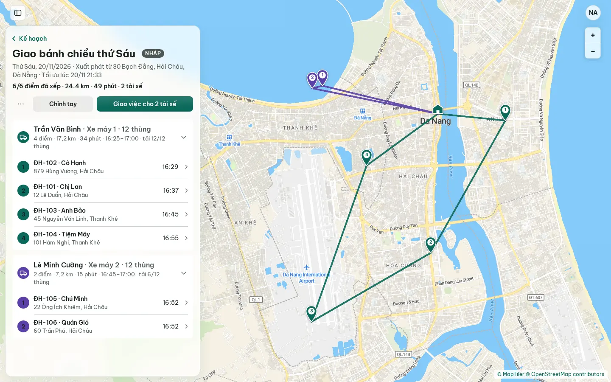
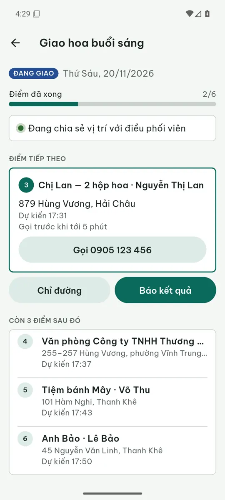
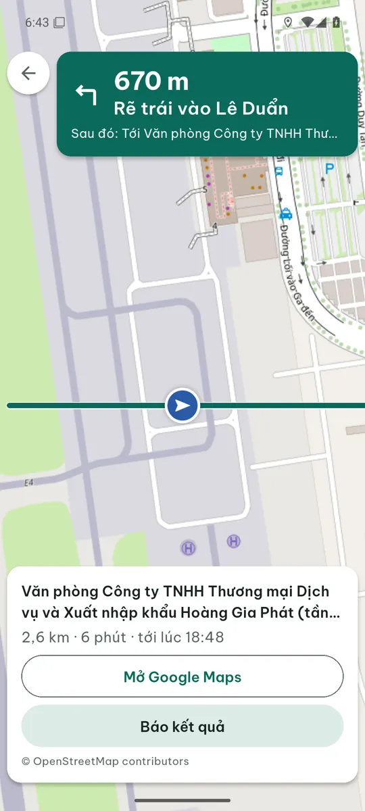
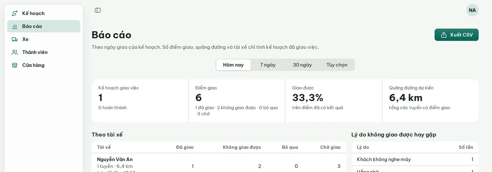

# PathWise

PathWise giúp cửa hàng có đội tài xế riêng sắp xếp việc giao hàng mỗi ngày. Chủ cửa hàng hoặc người điều phối nhập danh sách đơn; PathWise chia đơn cho từng xe, xếp thứ tự đi sao cho kịp khung giờ khách hẹn và không quá tải xe; tài xế nhận tuyến trên app Android, giao tới đâu báo kết quả tới đó, còn người điều phối theo dõi tiến độ và xem báo cáo trên web.

Hiện PathWise phục vụ các cửa hàng ở Đà Nẵng và Hội An.

## Sản phẩm đang chạy

- Trang giới thiệu: [pathwise.huy-vu.uk](https://pathwise.huy-vu.uk)
- Web điều phối: [pathwise.huy-vu.uk/app](https://pathwise.huy-vu.uk/app/) (đăng ký cửa hàng miễn phí)
- App tài xế Android: file `pathwise-driver.apk` trong [GitHub Release mới nhất](https://github.com/huyga1185/pathwise/releases/latest), cài trực tiếp (không có trên Play Store)

<p align="center">
  
</p>
<p align="center">
  
  &nbsp;
  
</p>
<p align="center">
  
</p>

## Tính năng chính

**Lập tuyến**
- Nhập đơn từng dòng hoặc tải lên file Excel, CSV; PathWise tự tìm toạ độ địa chỉ và chỉ ra địa chỉ cần kiểm lại.
- Tối ưu tuyến theo khung giờ giao, sức chứa và giới hạn quãng đường của từng xe, ca làm của từng tài xế; xem trước giờ tới dự kiến và quãng đường mỗi tuyến.
- Sửa tay: kéo điểm giao sang tuyến khác hoặc đổi thứ tự; sao chép kế hoạch sang ngày khác.

**Phân công tài xế**
- Giao việc một lần cho cả kế hoạch; PathWise chặn giao trùng ca của cùng tài xế hoặc cùng xe.
- Mời điều phối viên và tài xế qua email; chủ cửa hàng cũng có thể tự nhận tuyến.

**Theo dõi giao hàng**
- Tài xế xem tuyến theo thứ tự, dẫn đường ngay trong app hoặc mở Google Maps, báo đã giao, không giao được (kèm lý do) hoặc bỏ qua.
- Người điều phối thấy vị trí tài xế và kết quả từng điểm trên web.

**Báo cáo**
- Thống kê theo ngày, theo tài xế và lý do không giao được; xuất CSV để đối soát (tối đa 31 ngày mỗi lần).

## Kiến trúc

| Thành phần | Công nghệ |
|---|---|
| Backend (`be/`) | Spring Boot 4.1, Java 21, Flyway, tối ưu tuyến bằng Google OR-Tools |
| Web điều phối (`web/`) | React 19, Vite, TanStack Query, Leaflet |
| App tài xế (`mobile/`) | Flutter, Android |
| Cơ sở dữ liệu | MariaDB 11.8 |
| Trạng thái ngắn hạn | Redis (OTP, rate limit, cache toạ độ, vị trí tài xế) |
| Bản đồ và đường đi | OpenStreetMap, OSRM (đường đi, thời gian), Nominatim (toạ độ địa chỉ) |
| Phục vụ web và HTTPS | Caddy |

Các module backend, quy tắc phụ thuộc và luồng chính: [`docs/ARCHITECTURE.md`](docs/ARCHITECTURE.md). Hợp đồng API giữa backend và client: [`api/openapi.json`](api/openapi.json), sinh từ backend.

## Chạy trên máy

Cần Docker (Compose v2.24 trở lên); JDK 21 nếu chạy backend từ IDE.

```bash
cp .env.example .env
docker compose --profile app up -d --build    # MariaDB, Redis, Mailpit và backend ở http://localhost:8080
cd web && pnpm install && pnpm dev            # web điều phối ở http://localhost:5173/app/
```

Email (OTP, lời mời) gửi về Mailpit: http://localhost:8025. Chạy backend từ IDE, app tài xế, test, E2E và OSRM/Nominatim tự host: [`docs/DEVELOPMENT.md`](docs/DEVELOPMENT.md).

## Cấu trúc repository

| Thư mục | Nội dung |
|---|---|
| `be/` | Backend Spring Boot: API, tối ưu tuyến, migration Flyway, test (Testcontainers) |
| `web/` | Web điều phối (React), test Vitest và E2E Playwright |
| `mobile/` | App tài xế (Flutter) |
| `landing/` | Trang giới thiệu tĩnh ở `/`, viết tay, không build |
| `api/` | `openapi.json`, hợp đồng API dùng chung cho hai client |
| `brand/` | Logo và token giao diện (`design-system/tokens.json`) |
| `deploy/` | Cấu hình Caddy và script giám sát cho VPS |
| `scripts/` | Sinh OpenAPI, client Dart, theme và icon; dữ liệu demo |
| `docs/` | Yêu cầu, kiến trúc, API, dữ liệu, quyết định, kế hoạch, triển khai |

## Tài liệu

- [`docs/DEVELOPMENT.md`](docs/DEVELOPMENT.md): cài môi trường, chạy local, test, phát hành
- [`docs/REQUIREMENTS.md`](docs/REQUIREMENTS.md): yêu cầu nghiệp vụ
- [`docs/ARCHITECTURE.md`](docs/ARCHITECTURE.md): kiến trúc backend
- [`docs/API_SPEC.md`](docs/API_SPEC.md), [`docs/DATA_MODEL.md`](docs/DATA_MODEL.md): API và mô hình dữ liệu
- [`docs/DECISIONS.md`](docs/DECISIONS.md): các quyết định đã chốt
- [`docs/client/README.md`](docs/client/README.md): web và app tài xế
- [`docs/DEPLOYMENT.md`](docs/DEPLOYMENT.md): triển khai lên VPS
- [`docs/CURRENT_STATE.md`](docs/CURRENT_STATE.md): hiện trạng, lỗi đã biết
- [`AGENTS.md`](AGENTS.md): quy tắc cho coding agent

## Đóng góp

Quy trình branch, commit và CI: [`docs/CONTRIBUTING.md`](docs/CONTRIBUTING.md).

## Giấy phép

[MIT](LICENSE)
